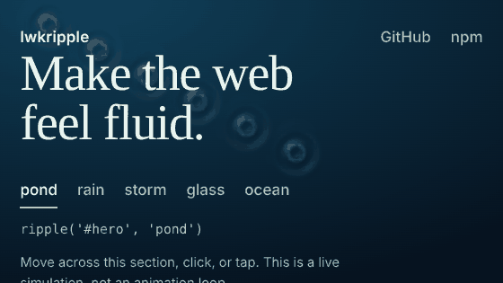

# Lwkripple

[](https://github.com/LwkMoon/lwkripple/actions/workflows/ci.yml)
[](LICENSE)

Make any section, button, image, or the whole page behave like water.



**[Live demo](https://lwkmoon.github.io/lwkripple/)**

Move the cursor, click, or touch, and real waves spread from that exact point, bounce off the edges, overlap, and fade. No shaders to write, no dependencies, about 10 KB gzipped.

```js
import { ripple } from 'lwkripple'

ripple('#hero', 'rain')
```

## Install

```
npm install lwkripple
```

Or with a script tag:

```html
<script src="https://unpkg.com/lwkripple"></script>
<section data-lwkripple="rain">...</section>
```

## Four places to use it

```js
ripple('#hero', 'pond')            // a section (any element is an "area")
ripple('.buy-button', 'glass')     // a button
ripple('img.product', 'pond')      // an image: the picture itself bends like it is under water
ripple('fullscreen', 'storm')      // the whole viewport, on top of the page, never blocks clicks
```

Your content stays crisp and clickable. The water draws behind your text, and the canvas ignores the pointer, so links, buttons and scrolling work as usual.

Pass a selector, an element, or a list of elements. A list returns one controller that drives all of them.

## Presets

| Preset  | What it is |
|---------|------------|
| `pond`  | Calm. Ripples follow the cursor and clicks. |
| `rain`  | Raindrops land by themselves. Delicate rings. |
| `storm` | Choppy and loud. Drops fall constantly, caustic light on the bottom. |
| `glass` | Very subtle, quick to settle. Good for buttons and cards. |
| `ocean` | Slow, large swells rolling in from the edges. |

```js
const water = ripple('#hero', 'pond')
water.setPreset('storm')
```

## Procedural water, with image refraction when you want it

By default there is no image: lwkripple draws light and shadow on the waves over whatever is behind it (a color, a gradient, a photo). It works anywhere with zero assets.

Opt in to real refraction, where the picture bends under the waves:

```js
ripple('#hero', { image: 'auto' })              // use the element's CSS background-image
ripple('#hero', { image: '/photos/lake.jpg' })  // a URL
ripple('#hero', { image: someCanvas })          // an , canvas, or ImageBitmap also work
ripple('img.product')                           // an  target refracts itself
```

`fit` is `'cover'` (default), `'contain'` or `'fill'`.

Cross-origin images need CORS headers and `crossorigin="anonymous"`, because the browser will not let WebGL read pixels it cannot verify. If an image is blocked, lwkripple logs a warning and falls back to plain water. Nothing breaks.

## Options

All optional.

| Option | Default | What it does |
|---|---|---|
| `preset` | `'pond'` | `pond`, `rain`, `storm`, `glass`, `ocean` |
| `image` | none | Refraction source (see above) |
| `fit` | `'cover'` | How the image fills the area |
| `color` | none | Water body color, any CSS color, alpha allowed |
| `highlight` / `shadow` | white / navy | Light and shadow colors |
| `opacity` | `1` | Overall opacity of the effect |
| `intensity` | `1` | Strength of lighting and refraction |
| `radius` | preset | Drop radius in CSS px |
| `strength` | `1` | Drop strength multiplier |
| `speed` | `1` | Wave speed. 1 is about 300 px per second at any size |
| `lifetime` | preset | Roughly how many seconds a ripple takes to fade |
| `hover` | `true` | Ripples follow the pointer (`false` on buttons) |
| `click` | `true` | Ripples on click or tap |
| `auto` | preset | `true`, `false`, or drops per second |
| `caustics` | preset | Light patterns on the bottom, `true`, `false` or 0 to 1 |
| `edges` | `'reflect'` | `'absorb'` stops waves bouncing. Used automatically on small areas like buttons |
| `layer` | `'under'` | `'over'` draws on top. Fullscreen always uses `'over'` |
| `zIndex` | 1 / 9999 | Canvas z-index when drawn over content, and for fullscreen |
| `renderer` | `'auto'` | `'webgl'` or `'canvas'` to force one |
| `resolution` | auto | Simulation cell size in CSS px. Bigger is faster and softer |
| `pixelRatio` | `min(dpr, 2)` | Canvas pixel ratio cap |
| `reducedMotion` | `'respect'` | `'ignore'` to always animate |
| `pauseOffscreen` | `true` | Stop when scrolled out of view |
| `onReady` | none | Called once running |

## Controller

`ripple()` returns a controller:

```js
const water = ripple('#hero', 'pond')

water.drop()                       // random spot
water.drop(200, 120)               // x, y in CSS px inside the area
water.drop(200, 120, 1.5, 30)      // + strength, radius
button.addEventListener('click', (e) => water.drop(e))   // at a pointer event

water.setPreset('storm')
water.update({ intensity: 1.4, color: 'rgba(10,60,90,.5)' })
water.pause()
water.resume()
water.clear()                      // flatten the water
water.destroy()                    // removes the canvas and restores the page
water.renderer                     // 'webgl' or 'canvas'
```

Calling `ripple()` on an element that already has one replaces the old effect.

## React

```jsx
import { Ripple, useRipple } from 'lwkripple/react'

<Ripple preset="rain" className="hero" id="top">
  <h1>Hello</h1>
</Ripple>

// or as a hook
function Card() {
  const ref = useRipple('glass')
  return <section ref={ref}>...</section>
}
```

`<Ripple>` accepts every option as a prop, forwards normal props (`className`, `id`, `data-*`, `onClick`) to the element, and updates live when props change. A ref gives you the controller. React is an optional peer dependency.

## Script tag and data attributes

```html
<section data-lwkripple="storm" data-lwkripple-intensity="1.2">...</section>
<div data-lwkripple="pond" data-lwkripple-image="auto" style="background-image:url(lake.jpg)"></div>
<script src="https://unpkg.com/lwkripple"></script>
```

Attributes: `data-lwkripple` (preset), `-image`, `-color`, `-intensity`, `-radius`, `-speed`, `-lifetime`, `-auto`, `-hover`, `-click`, `-layer`. Put it on `<body>` for a fullscreen effect. With a bundler, call `autoInit()` yourself. Set `window.LWKRIPPLE_NO_AUTO = true` before the script to turn auto-init off.

## How it works

It is a real water simulation, not drawn circles. Each area holds a small height grid that runs the wave equation, so ripples spread, interfere and reflect off edges on their own. Every drop has zero net volume, so the water never drifts.

Two renderers draw the same water with the same lighting:

- **WebGL2** (default): the grid goes to the GPU, which does lighting and image refraction per pixel.
- **Canvas 2D**: used automatically when WebGL2 is missing or fails. Same look, drawn at grid resolution and scaled up.

The loop sleeps when the water is calm, when the area is scrolled out of view, and when the tab is hidden.

## Performance and accessibility

- One small canvas per area. Grid size and canvas pixels are capped, so a fullscreen effect stays affordable.
- Wave speed in px per second does not change with resolution or frame rate.
- With `prefers-reduced-motion`, automatic drops and hover ripples switch off, click ripples are gentler and fade faster.
- The canvas is `aria-hidden` and never takes the pointer.
- Safe to import on the server. Calling `ripple()` without a DOM returns an inert controller.

## Limits, honestly

- It bends images and backgrounds, not text. Text and other content on top stays sharp by design.
- `<input>`, `<video>`, `<canvas>`, `<select>` and similar elements cannot hold children. Put them in a container and target that.
- An `` target is wrapped in a small `<span>` while the effect runs (removed on `destroy()`). Layouts that depend on the image being a direct child can be affected.
- Fullscreen draws over the page with a transparent overlay, so it adds light and shadow rather than bending the page.
- If the target sits inside a CSS transform that scales it, pointer positions can be slightly off.

## Develop

```
npm install
npm run typecheck
npm test              # simulation tests in Node
npm run build         # ESM, CJS, global script, types
python3 test/browser.py   # real-browser checks (needs Playwright with Chromium)
```

## Contributing

Issues and pull requests are welcome. See [CONTRIBUTING.md](CONTRIBUTING.md). Release notes are in [CHANGELOG.md](CHANGELOG.md).

## License

MIT
